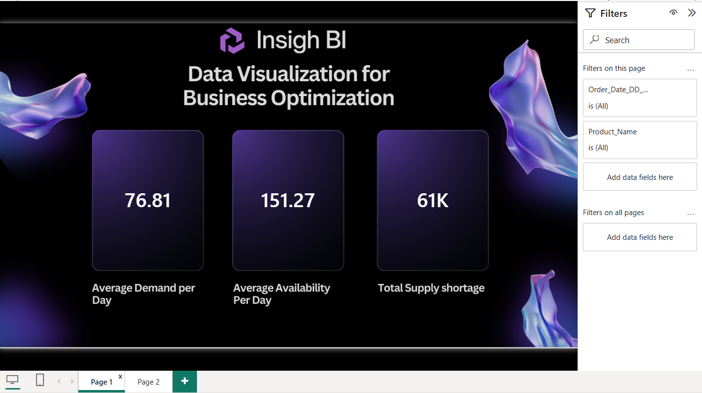

# Inventory Management Analysis | Power BI & SQL

An end-to-end Inventory Management Analytics project using SQL and Microsoft Power BI. This project focuses on analyzing inventory availability, demand, supply shortages, and profit/loss metrics through data preparation, SQL queries, and interactive Power BI dashboards.

## Project Overview

The objective of this project is to analyze inventory data and develop meaningful business insights using SQL and Power BI.

The project uses production and test-environment inventory datasets along with product information to explore inventory demand, availability, supply shortages, and financial performance.

## Tools & Technologies

- **Microsoft Power BI** – Dashboard development and data visualization
- **SQL Server** – Data querying, inspection, and transformation
- **MySQL Workbench** – SQL queries, table creation, and data manipulation
- **CSV** – Dataset storage and data handling

## Repository Structure

```text
PowerBI-Inventory-Management/
│
├── Dashboard/
│   └── Inventory_Management.pbix
│
├── Dataset/
│   ├── Products.csv
│   ├── Prod_Env_Inventory_Dataset.csv
│   └── Test_Environment_Inventory_Dataset.csv
│
├── SQL/
│   ├── SQLQuery1.sql
│   ├── workbench.sql
│   └── workbench_new_table.sql
│
├── Screenshots/
│   ├── Page_1.png
│   └── Page_2.png
│
└── README.md
```

## Dataset Description

The project includes three datasets:

| Dataset | Description |
|---|---|
| Products.csv | Contains product information, including product names and unit prices |
| Prod_Env_Inventory_Dataset.csv | Production environment inventory records |
| Test_Environment_Inventory_Dataset.csv | Test environment inventory records |

## SQL Analysis & Data Preparation

SQL was used to prepare and organize the inventory data before visualization.

Key operations include:

- Database and table creation.
- Inspecting datasets and checking distinct values.
- Checking for missing or blank order dates.
- Updating product IDs in the production dataset.
- Using LEFT JOIN to combine inventory records with product details.
- Creating a consolidated table containing order date, product ID, availability, demand, product name, and unit price.

The SQL scripts are available in the `SQL` folder.

## Power BI Dashboard

The Power BI report provides visual insights into inventory performance through KPI cards and data visualizations.

### Key Performance Indicators (KPIs)

- Average Demand per Day
- Average Availability per Day
- Total Supply Shortage
- Total Profit
- Total Loss
- Average Daily Loss

## Dashboard Screenshots

### Page 1 – Inventory Demand, Availability & Supply Shortage



### Page 2 – Profit & Loss Analysis


## How to Run the Project

1. Clone or download this repository.
2. Import the CSV datasets into your SQL environment.
3. Execute the SQL scripts using the appropriate database environment.
4. Open the `.pbix` file using Microsoft Power BI Desktop.
5. If prompted, update the data source paths to match your local dataset locations.
6. Explore the dashboard and its visualizations.

## Key Learning Outcomes

- Working with structured datasets.
- Writing SQL queries for data preparation.
- Understanding and implementing LEFT JOIN operations.
- Creating consolidated datasets.
- Developing interactive dashboards in Power BI.
- Analyzing inventory performance using KPIs.

## Author

**Sagaljot Singh**

---
